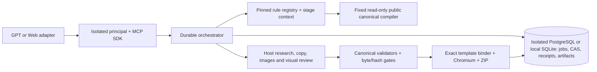

# UID Brands Architecture V2 — isolated experiment

Branch `experiment/uid-brands-architecture-v2`, based on production/main `87bf39d1f38eb1d0baee159b921efbd7e3aaf923` (2026-11-27). This is an isolated Onepage backend for PawfectHouse, GiftSoul and SoulPrise. This revision configures the requested public test mode with **no authentication**. It does not import the writable production server, deploy migrations, publish storefronts or submit training.

**Experimental, not accepted for production.** The requested connection is `https://uid-brands-architecture-v2-test.onrender.com/api/mcp` with authentication **None**, omitting the Authorization header. Public access is explicitly restricted to this isolated test origin and uses durable isolated PostgreSQL. Confirm activation through `/healthz`: `authRequired:false`, `publicSandbox:true`, `authMode:"public-test"`. Source configuration alone is not a live-deployment claim; current deployment and no-token checks are recorded in `docs/deployment-plan.json` and the public handover evidence. The earlier plugin creation attempt was rejected by workspace MCP permission (HTTP 403); changing endpoint authentication does not remove that workspace restriction. Full creative Onepage runs, actual GPT token accounting and blinded EO non-regression are not established.

Anonymous requests share the `public-v2-sandbox` owner. Anyone who knows a public job ID can read or change that public job, so use public or synthetic test material. Each new job needs a unique idempotency key; reuse that key only for retries or resuming that same job. Public approvals are anonymous test actions, not verified identity or proof of human inspection. Existing private jobs and artifacts remain under their prior owners and are inaccessible anonymously. An explicitly supplied invalid credential is rejected instead of falling back to public access.

## Boundaries



- `compiler.ts` admits only the verified public compiler route and same-brand product/collection URLs. It never forwards bearer credentials, accepts arbitrary upstream operations, or writes to Supabase. Private research/credentials are rejected before public upstream transfer.
- `rules.ts` preserves complete packet text, unknown fields, provenance and full lookup. Only structurally equal duplicates alias. Unknown scope remains visible. Conflicts, missing dependencies and unclassified execution steps block advancement. All current canonical rules remain visible in each stage bundle; layouts load only after a GTK/FAQ decision.
- `wire-state.ts` removes repeated step lists and known image dimensions from routine state replies, preserving exact hashes, blockers, approvals and unknown fields. `onepage_get_state` with `detail:"full"` returns the original full summary. `wire-context.ts` removes only duplicate receipt ID/hash metadata, referencing the complete coverage object in that same response. `detail:"full"` restores the original stage response. Stored receipts and their bundle hashes are unchanged.
- Repeated `getStageContext` calls still return every required rule. If every receipt in the stage group already matches exactly, no new job/history revision is written. State exposes a verified context identity; it is server coverage, not proof that the host remembers the rules. Reload after context loss, reconnect, stage/template/snapshot change. Otherwise the host can reuse rules actually retained in its context and the revision already returned by a successful action. Telemetry can still record reads.
- `orchestrator.ts` retains all 23 observed canonical substeps plus final overall review/package/complete boundaries. One context bundle covers a stage group; backend advancement records each ready substep without asking the model to orchestrate each separately. Research recompilation uses atomic CAS; stale responses cannot replace newer state. Explicit content review is optional when requested; final review/package authorization is required.
- `store.ts` ports the existing owner/revision/immutable receipt patterns into a **separate local namespace**. SQLite transactions, WAL, full synchronization, leases/fencing, request idempotency, TTL and bounded storage support local crash/restart recovery. `postgres-store.ts` provides the same asynchronous interface for a separate PostgreSQL project: transaction-local owner identity, FORCE RLS, least-privilege runtime role, CAS, immutable receipts and global quota locking. Its default logical storage cap is 128 MiB; physical database usage includes additional indexes/row overhead. The explicit migration is never run on startup.
- `delivery.ts` imports the existing pure binder, asset decoder and canonical packaging paths. It validates exact bytes, renders unchanged CSS/HTML at desktop/mobile/breakpoints with browser egress disabled, and validates actual reopened ZIP CRCs, names and decoded images. Technical checks never establish artistic review.
- `auth.ts` supports the explicitly enabled `public-test` shared sandbox, provisioned opaque test credentials, or an isolated JWT issuer/JWKS plus explicit membership. Public mode is restricted to the exact new V2 origin and `isolated-test` mode. Optional valid opaque credentials retain their prior private owner. Production Supabase issuer/keys are rejected. `server.ts` uses the supported MCP SDK transport, owner-bound artifact transfer, strict Host/Origin admission, request limits and redacted errors.

The preflight/reuse matrix in `docs/` explains why Studio's seven-stage, eight-image executor was not ported, and records actual deployed/Git divergence. Existing canonical modules and non-Onepage routes are unchanged.

## Install and run locally

Node 24.14+ is required. The root repository has no npm lock; V2 has its own checked-in lock. The existing separate image-quality runtime pins Sharp.

```sh
npm install --ignore-scripts --package-lock=false
npm install --prefix tools/creative-quality --ignore-scripts --package-lock=false
npm ci --prefix v2
cd v2
npx playwright install chromium
cd ..
node --import tsx v2/scripts/init-local.ts /absolute/private/uid-v2-state owner-id
node --env-file=/absolute/private/uid-v2-state/settings.env --import tsx v2/server.ts
```

The local provisioner creates **new local test credentials only**, records the explicitly selected sandbox owner, refuses to overwrite existing credentials, and writes private 0600 files. It never creates a production UID member. Keep the generated directory outside Git; do not paste tokens into logs or chats. Default endpoint: `http://127.0.0.1:4318/api/mcp`; health: `/healthz`.

The local example above remains private: send its provisioned opaque token using `Authorization: Bearer`. Artifact uploads use `POST /v2/jobs/{jobId}/artifacts` with actual PNG/JPEG/WebP bytes; downloads use `GET /v2/jobs/{jobId}/artifacts/{sha256}`. Small images can also transfer through MCP upload/read tools. In the deployed public mode, omit authentication for public sandbox artifacts. Ownership checks still protect old private artifacts; public callers all share one owner.

For an optional isolated OAuth deployment configure `V2_AUTH_MODE=jwt`, `V2_JWT_ISSUER`, `V2_JWT_AUDIENCE`, `V2_JWKS_URL`, `V2_MEMBERS_JSON`, `V2_OAUTH_CLIENT_IDS_JSON`, and `V2_OAUTH_REQUIRED_SCOPES_JSON`. These must describe a real separately provisioned provider and members. `oauth.ts` optionally serves an existing-password-account login and consent UI. Enable only after following `docs/oauth-activation.json`: configure the actual member, exact ChatGPT callback, client registration and resource-specific token audience policy. The UI verifies separate login tokens with audience `authenticated`, binds consent to the reviewed client/scope/destination and rechecks callback/action before returning to the client. It creates no users, sends no emails and stores no browser login/refresh credentials. OTP/SSO/MFA UI is not implemented. OAuth remains disabled and is unnecessary for the public endpoint or the plugin package's native `auth.type: none`. Actual GPT discovery/call/asset transfer remains a separate acceptance check.

## Verification

```sh
npm run lint --prefix v2
npm run build --prefix v2
npm test --prefix v2
npm test
npm run lint
npm run build
```

Baseline root test/typecheck failures existed before V2. See the acceptance report; a successful V2 suite does not make those legacy failures pass. No production SQL regression tests are run. Synthetic test images, local fixtures and host inspection attestations are labeled as such and are not approved EO examples.

Benchmark with **authorized local** canonical exports outside Git:

```sh
node --import tsx v2/benchmark.ts /private/path/to/snapshot-directory
node --import tsx v2/optimization-benchmark.ts /private/path/to/snapshot-directory
```

Metrics are bytes/characters and measured server timings. Unknown model input/output/reasoning/cached tokens and costs remain null. A smaller stage bundle or tool schema is not proof of lower billed tokens, completion rate, or EO. The 36-run creative A/B matrix has not run; no paid model/image calls are initiated by this implementation.

## Workflow notes

Start with a real product/collection URL or exact product-line name and actual capability declarations. Name-only inputs require an exact Shopify product-type report, complete contiguous catalog pagination ending in an empty page, exact researched PDP coverage, and an actual supplied source URL before research compilation. These are host-reported evidence and require bound research QC; V2 does not claim a server catalog scan. Request stage context, transfer the real inspected evidence, submit structured research through the compiler, then submit the content plan, allocations, assets and required QC reports. `onepage_advance` checks prerequisites and records only steps justified by persisted evidence. Unavailable optional references follow the pinned canonical fallback; explicit required references stay blocked. Source/review data remains untrusted evidence, never authorization.

Canonical QC helpers evaluate submitted reports; V2 binds those reports to current bytes, plans, sources and revisions and records the actor. Public mode records an anonymous, identity-unverified actor. The host/human still must genuinely inspect pixels. A public reviewer capability does not authorize automatic approval or establish a human review. V2 never claims its structural evaluator performed semantic vision. Video-byte validation is not implemented: video inspection receipts cannot falsely pass; affected video evidence remains blocked.

Targeted asset revisions preserve unaffected hashes and copy, invalidate dependent QC and the overall render, and require a new overall review. Product-truth/content changes invalidate their dependents. Packaging uses the latest reviewed exact bytes, fresh canonical compatibility check, canonical image ZIP and separate preview/manifest artifacts. Archive receipt identifiers do not substitute for real archive bytes.

## Deployment boundary and rollback

The new Free Render service `uid-brands-architecture-v2-test` is live at `https://uid-brands-architecture-v2-test.onrender.com/api/mcp`, explicitly on this experiment branch, manual deployments only, with its own secrets and state. There is no production deployment workflow. Existing gateway, Lean, Studio and unrelated services must not be changed.

Cloud state uses the independent Free Supabase project `muyyitsvkkjzjojetynr` (`uid-brands-architecture-v2-test`, Singapore), with schema `uid_brands_v2` and role `uid_brands_v2_app`. Production project `wuonwttmkadwsmefjukv` is explicitly denied. Only the new test project received `migrations/001_isolated_v2_store.sql`. The runtime role has no schema creation, role creation, RLS bypass, inherited roles or table ownership. Raw PostgreSQL client access has verified TLS and hostname checking using the official CA. Credentials stay outside Git.

Select `V2_STORE=postgres`, set `V2_DATABASE_URL`, exact `V2_DATABASE_HOST`, `V2_DATABASE_PROJECT_REF` and `V2_DATABASE_CA_PEM`. Public testing requires `V2_MODE=isolated-test`, `V2_AUTH_MODE=public-test`, and the exact new V2 HTTPS origin. Optional opaque credentials can be retained through exactly one of `V2_TEST_PRINCIPALS_FILE` or `V2_TEST_PRINCIPALS_JSON`; these contain SHA-256 token digests plus private owner/subject/role assignments. The anonymous owner and subject are reserved. JWT mode requires real isolated provider membership. Never supply an admin or production database URL.

`v2/Dockerfile` pins Node 24.14.1, installs the V2 lockfile plus Chromium and its OS dependencies, and runs as an unprivileged user. A root node_modules symlink exposes the same locked runtime dependencies to unchanged canonical modules. The Docker context is the repository root; Dockerfile path is `v2/Dockerfile`; `/healthz` is the health check. Render Free state is ephemeral, so SQLite mode refuses to start there without a verified persistent mount. PostgreSQL mode keeps durable jobs and actual artifact bytes outside the web-service filesystem. No paid compute or disk is selected. Free-service cold starts and shared workspace usage limits still apply.

The deployed Render service uses the experiment branch with auto-deploy **Off**. Current deployment status and deployed SHA are recorded in `docs/deployment-plan.json`; the public handover contains current no-token checks. Earlier bearer-mode reports remain historical evidence. Public MCP transport success does not establish a real GPT connection. Supabase OAuth remains disabled; no test identity is invented as the owner. Verify actual GPT initialization/discovery/calls and real asset transfer before describing GPT end-to-end acceptance as passed.

Local rollback: stop the V2 process, preserve the V2 state directory, and check out a prior V2 commit if schema-compatible. Cloud rollback: redeploy a verified previous commit **only on that new V2 service**, then rerun auth/isolation checks. This does not restore databases. Never use production deploy hooks, reset main, merge this branch or restore production data as rollback.

## Endpoint handover and reusable test kit

`test-kit/README.txt` documents the dependency-free Node 24 no-token public smoke and read-only recovery checks. The public smoke writes only synthetic test state to the exact isolated V2 origin, using a unique job key. Optional private-mode checks require an explicitly supplied token file; no credentials are packaged. Supabase test data has a seven-day TTL and can expire; persistence reports capture the actual verification time.

The plugin source at `plugin/uid-brands-v2-test/` points to the isolated endpoint and declares native **`auth.type: none`**. It requires no token, Supabase Auth user or OAuth callback. Plugin creation previously returned a nonretryable workspace permission 403; no plugin was created and the production plugin remains unchanged. Do not retry creation until workspace permission changes. A permitted host can connect directly with authentication None; successful host discovery/start/context/artifact tests are still required before claiming a real GPT connection.

`creative-benchmark.ts` provides an offline blinded 36-run study kit with 72 scorecards, pinned source metadata and actual usage fields. `docs/creative-study-protocol.json` explains execution, review and acceptance. Nine case positions and 15 public product metadata responses were verified; this is source metadata evidence only. Real pixel inspection, generation, EO review and token measurement remain NOT RUN.
